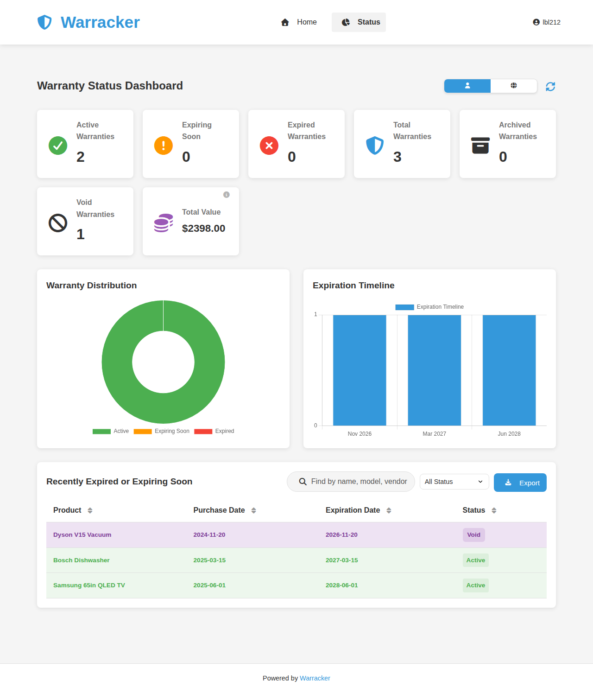

<div align="center">
    


<h1><strong>Warracker</strong></h1>
<p align="center">
    <b>Open-source warranty tracker for individuals and teams.</b> <br/>
The easiest way to organize product warranties, monitor expiration dates, and store receipts or related documents.
</b>
</p>
</div>


<div align="center">
    


[](https://github.com/sassanix/Warracker/actions/workflows/tests.yml)
[](https://github.com/sassanix/Warracker/wiki)
[](https://discord.gg/PGxVS3U2Nw)
[](https://deepwiki.com/sassanix/Warracker)

<p align="center">
  
</p>

</div>

⭐ If you find Warracker helpful, we’d truly appreciate a star on GitHub! Your support motivates us to keep improving and building great new features.

## 🌟Overview

**Warracker** is a web-based application that simplifies the management of product warranties. It allows users to organize warranty information, monitor expiration dates, and securely store related documents.

Full guides live in the [Warracker Wiki](https://github.com/sassanix/Warracker/wiki): setup, the complete user guide, configuration, backup and restore, updating, reverse proxies, security, troubleshooting, and contributing.


## 🔑 Key Features

| **Feature**                      | **Description**                                                                                          |
| -------------------------------- | -------------------------------------------------------------------------------------------------------- |
| 🗃️ **Centralized Management**   | Track all your product warranties in one place                                                           |
| 🧾 **Detailed Records**          | Store purchase dates, durations, notes, multiple serial numbers, and product photos with thumbnail previews |
| 📄 **Document Storage**          | Upload receipts, invoices, and manuals securely                                                          |
| 📝 **[Warranty Claims](https://github.com/sassanix/Warracker/wiki/User-Guide#-claims)** | Manage warranty claims end-to-end with statuses, dates, resolutions, attached documents, and full lifecycle visibility |
| 🔔 **[Proactive Alerts](https://github.com/sassanix/Warracker/wiki/Notifications)** | Get alerts for upcoming expirations via email or 100+ push services (Discord, Slack, etc.) using Apprise — each threshold notifies once, never daily repeats |
| 🔍 **Quick Search and Filter**   | Search by product name, serial number, vendor, and more with real-time filtering, and organize with custom tags |
| 👥 **Multi-User & Global View**  | Multiple accounts with admin controls; authenticated users can view global warranty data with role-based permissions |
| 📤 **[Data Export/Import](https://github.com/sassanix/Warracker/wiki/User-Guide#-csv-import-and-export)** | Import/export warranty data via CSV — exports include every field (notes, currency, model, warranty type), so a re-import restores your data exactly |
| ⚙️ **Customizable Settings**     | Configure currency, date formats, notification timing, and branding                                      |
| 📦 **Archiving**                 | Archive expired or unused warranties for better organization, while keeping records accessible when needed |
| 🔑 **[OIDC SSO](https://github.com/sassanix/Warracker/wiki/Authentication#-oidc-single-sign-on)** | Single sign-on with providers like Google, GitHub, and Keycloak                                          |
| 📊 **[Status Dashboard](https://github.com/sassanix/Warracker/wiki/User-Guide#-status-dashboard)** | Visual analytics and stats with charts, tables, and global/user views — including Total Value (in your default currency) and Archived summary cards, plus CSV export of the filtered view |
| 📦 **[Paperless-ngx Integration](https://github.com/sassanix/Warracker/wiki/Paperless-ngx)** | Store/manage documents directly in Paperless-ngx with file-level control                                 |
| 📖 **Localization Support**      | [Full multilingual UI with 20 languages](https://github.com/sassanix/Warracker/wiki/User-Guide#languages), RTL support, instant language switching, and native name display |


---

## Project Status

**Warracker is in active development.**
The essential features are reliable and ready for everyday use. Development is ongoing, with regular updates and improvements.

* ✅ Stable core for tracking, notification , and managing warranty documents, files
* ✅ Full support for self-hosted deployments
* ⚒️ Advanced enhancements are still being worked on
* ✍️ Your feedback and bug reports help shape the future of the app

## 📸Screenshots

**Home Page**


**Status Dashboard**




## 🛠️Technology Stack

*   **Frontend**: HTML, CSS, JavaScript
*   **Backend**: Python with Flask
*   **Database**: PostgreSQL
*   **Containerization**: Docker and Docker Compose
*   **Web Server**: Nginx

## 🗺️Roadmap

What's planned next — 1.0.4, in final testing now, then 1.0.5, plus the feature requests under consideration — lives on the [Roadmap](https://github.com/sassanix/Warracker/wiki/Roadmap) page in the wiki. Shipped work is in the [changelog](CHANGELOG.md) and the [releases](https://github.com/sassanix/Warracker/releases).

## 🚀Setup

### Prerequisites

*   Docker and Docker Compose installed on your system.

### Steps

```bash
mkdir warracker && cd warracker
curl -O https://raw.githubusercontent.com/sassanix/Warracker/main/Docker/docker-compose.yml
curl -O https://raw.githubusercontent.com/sassanix/Warracker/main/Docker/.env.example
mv .env.example .env
```

1. Fill in the required values in your `.env` file (database credentials, `SECRET_KEY`, etc.).
2. Start the stack:
    ```
    docker compose up -d
    ```
3. Open `http://localhost:8005` in your browser. The first account you create automatically becomes the admin.

The [Getting Started](https://github.com/sassanix/Warracker/wiki/Getting-Started) guide walks through each install route step by step, and [Configuration](https://github.com/sassanix/Warracker/wiki/Configuration) documents every `.env` variable.

### Other platforms

[](https://ca.unraid.net/apps/warracker-0pkvcdo0mizgxc)
[](https://github.com/sassanix/Warracker/tree/main/proxmox)
[](https://github.com/sassanix/Warracker/tree/main/truenas)

One-click installs on Unraid (Community Apps), Proxmox VE (community helper script), and TrueNAS SCALE (Apps catalog) — see the [`proxmox/`](https://github.com/sassanix/Warracker/tree/main/proxmox) and [`truenas/`](https://github.com/sassanix/Warracker/tree/main/truenas) guides.

<details>
<summary>Full <code>docker-compose.yml</code> reference</summary>

```
services:
  warracker:
    image: ghcr.io/sassanix/warracker/main:latest
    ports:
      - "8005:80"
    volumes:
      - warracker_uploads:/data/uploads
    env_file:
      - .env
    depends_on:
      warrackerdb:
        condition: service_healthy
    restart: unless-stopped

  warrackerdb:
    image: postgres:15-alpine
    volumes:
      - postgres_data:/var/lib/postgresql/data
    env_file:
      - .env
    restart: unless-stopped
    healthcheck:
      test: ["CMD-SHELL", "pg_isready -U $$POSTGRES_USER -d $$POSTGRES_DB"]
      interval: 5s
      timeout: 5s
      retries: 5

volumes:
  postgres_data:
  warracker_uploads:
```

</details>

## 📝 Usage

The [User Guide](https://github.com/sassanix/Warracker/wiki/User-Guide) walks through every screen, button, and field; the essentials are below.

### Accounts & Roles

- The **first account created** in the system will automatically become the **Admin account**.  
- The Admin can manage other users, assign roles, and has full system permissions.  
- Regular users can only manage their own warranties unless granted additional privileges by the Admin.  

### Adding a Warranty

1. Fill in the product details by clicking on **Add Warranty**.  
2. Enter the purchase date and warranty duration.  
3. Optionally upload receipt/documentation.  
4. Click the **Add Warranty** button.  

### Managing Warranties

- Use the search box to filter warranties.  
- Click the edit icon to modify warranty details.  
- Click the delete icon to remove a warranty.  
- A warranty that expires today is still counted as active (not expired) across the dashboard, warranty lists, and expiry notifications.  


To import, click **Data** > **Import** and choose a CSV file. The full field reference — formats, which fields are required, and how exports encode values — is in the [User Guide](https://github.com/sassanix/Warracker/wiki/User-Guide#csv-import-and-export).

---


## 🌐 Localization Support

Warracker offers **full multilingual UI support** with **20 languages**, including **RTL (Right-to-Left) support**, instant language switching, and native name display. The language is auto-detected from your browser on first visit and saved to your profile. The full list of supported languages is in the [User Guide](https://github.com/sassanix/Warracker/wiki/User-Guide#languages).

---

## Why I Built This

Warracker was born from personal frustration with warranty confusion. When my father’s dishwasher broke, we had the invoice and assumed it was under warranty, only to find out we were referencing the wrong one, and the warranty had ended by a couple of months.

That experience, along with others like it, made me realize how common and avoidable these issues are. So I built **Warracker**, a simple, organized way to track purchases, receipts, and warranties. It has already saved me money by reminding me to get car repairs done before my warranty expired.

Inspired by [**Wallos**](https://github.com/ellite/Wallos), I wanted to bring the same clarity to warranties that it brought to subscriptions and share it with anyone who's ever been burned by missed coverage.


## Contributing

We welcome contributions and appreciate your interest in improving this project! The [Contributing](https://github.com/sassanix/Warracker/wiki/Contributing) page in the wiki covers the development environment setup and how translations work. To get started, please follow these steps:


### How to Contribute

1. **Fork** the repository.
2. **Create a branch** for your changes:
   `git checkout -b feature/amazing-feature`
3. **Commit** your changes:
   `git commit -m "Add: amazing feature"`
4. **Push** to your forked repository:
   `git push origin feature/amazing-feature`
5. **Open a Pull Request** with a clear explanation of your changes.

### 📌Contribution Guidelines

* **Start with an issue**: Before submitting a Pull Request, ensure the change has been discussed in an issue.
* **Help is welcome**: Check the [issues](../../issues) for open discussions or areas where help is needed.
* **Keep it focused**: Each Pull Request should focus on a single change or feature.
* **Follow project style**: Match the project's code style and naming conventions.
* **Be respectful**: We value inclusive and constructive collaboration.

### 🤝Contributors:  
<a href="https://github.com/sassanix/warracker/graphs/contributors">
  
</a>

### ❤️Supporters:

[](https://github.com/SirSpidey)
[](https://github.com/keithellis74)
[](https://github.com/CristianKerr)
[](https://github.com/rssmithtx)
[](https://github.com/Morethanevil)


[](https://buymeacoffee.com/sassanix)


## Join Our Community

[](https://discord.gg/PGxVS3U2Nw)

Want to discuss the project or need help? Join our Discord community!

## 🔒Security

Found a vulnerability? Please report it privately instead of opening a public issue — open a [private security advisory](https://github.com/sassanix/Warracker/security/advisories/new) or reach out on [Discord](https://discord.gg/PGxVS3U2Nw). We credit all responsible disclosures in the release notes and README acknowledgements. Hardening guidance — HTTPS, secrets, closing registration, backups — is on the [Security](https://github.com/sassanix/Warracker/wiki/Security) page in the wiki.

## 📜License

This project is licensed under the GNU Affero General Public License v3.0 - see the [LICENSE](LICENSE) file for details.

## 🙏Acknowledgements

*   [Flask](https://flask.palletsprojects.com)
*   [PostgreSQL](https://www.postgresql.org)
*   [Docker](https://www.docker.com)
*   [Chart.js](https://www.chartjs.org)
*   [Apprise](https://github.com/caronc/apprise)
*   [i18next](https://www.i18next.com)
*   [Font Awesome](https://fontawesome.com)

### Security researchers
*   [humidnhefty](https://github.com/humidnhefty) and the CSCE 413 (Texas A&M University) vulnerability-research team — Carrigan Royer, Jayani Singh, Seshadithya Saravanan, Aaditya Srinivasan, Miko Quinones — for the responsible disclosure of a stored XSS vulnerability.
*   [humidnhefty](https://github.com/humidnhefty) (Malik Abdullah, Lupine Security) — for the responsible disclosure of an authorization bypass on the `/api/files/` document-serving route.


## ⭐Star History
<a href="https://star-history.com/#sassanix/Warracker&Date">
 <picture>
   <source media="(prefers-color-scheme: dark)" srcset="https://api.star-history.com/svg?repos=sassanix/Warracker&type=Date&theme=dark" />
   <source media="(prefers-color-scheme: light)" srcset="https://api.star-history.com/svg?repos=sassanix/Warracker&type=Date" />
   
 </picture>
</a>
